# La acampada que permanece

G3 · Ribera de Curtidores 31 · 5 octubre 2026

16 imágenes originales generadas con la herramienta integrada de imágenes de Codex. Abrir ABRIR_GALERIA.html para verlas, filtrarlas y ampliarlas; usar las flechas para recorrer la serie. Los prompts completos están en prompts.json.

## Tesis de trabajo

Convertir la solidaridad temporal en infraestructura doméstica duradera. La habitación propia protege la intimidad; el grupo permite pactar una convivencia cercana; la comunidad comparte recursos; la planta baja conecta con el barrio. La posición política se materializa en quién tiene derecho a decidir, a retirarse, a recibir cuidados, a usar las herramientas y a disfrutar el mejor espacio.

Las hipótesis de tenencia colectiva y cesión de uso proceden de la conversación aportada. Aquí se plantean como decisiones por desarrollar, no como un régimen jurídico ya definido. Compartir cocinas o poner una pancarta no garantiza por sí solo vivienda fuera de la especulación.

## Tres motores para empezar

1. **Comuna de patio:** 01 + 05 + 06 + 13. Empezar por dibujar el vacío, después los lugares donde se ensancha la galería, después las puertas privadas. Pregunta: ¿cuánta vida compartida cabe sin invadir el descanso?
2. **Infraestructura abierta:** 02 + 04 + 09 + 10 + 11. Empezar por recorridos, instalaciones registrables y lugares que admiten transformación. Pregunta: ¿qué se puede cambiar sin romper la casa ni obligar a sus habitantes a mudarse?
3. **Lujo colectivizado:** 03 + 08 + 12 + 14. Empezar por el cielo disponible, la luz y la sección; repartir después estancias y cuidados. Pregunta: ¿cómo hacer que el mejor lugar no dependa de quién paga más?

## Conexiones transversales

- **Acampada → comisión → espacio → responsabilidad:** comida/cocina; limpieza/lavandería; infraestructura/taller; acogida/umbral; asamblea/sala reversible. Cada espacio necesita recursos y acuerdos de uso.
- **Rastro → material → taller → vivienda → Rastro:** el edificio almacena, repara y transforma; los textiles pueden pasar del taller a la sombra del patio.
- **Sol escaso → sección → comunes arriba:** la escasez climática lleva a discutir cómo se reparte el espacio. La imagen no sustituye el modelo de sombras.
- **Corrala → galería → umbral → intimidad:** el encuentro necesita espesor y lugares de estancia; el dormitorio necesita poder cerrarse.
- **Temporalidad → continuidad:** cambia la persona, permanece el derecho de uso durante su estancia; quedan herramientas, memoria y conocimiento para quien llega.
- **Instalaciones fuera → reparación accesible → menos obra dentro:** una hipótesis de mantenimiento que exige resolver clima, seguridad, acústica y espacio de paso.

## Los dieciséis dibujos

### 01 · CORRALA INSUMISA

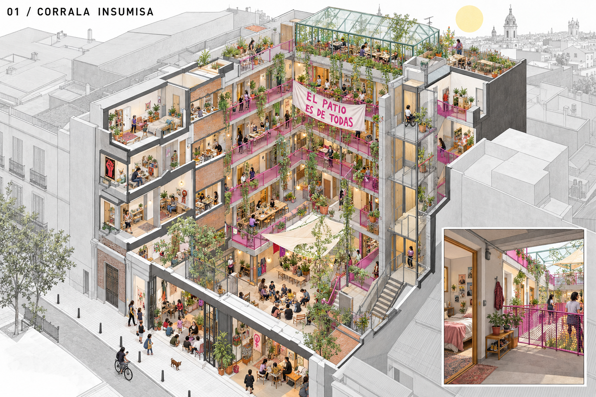

La corrala se convierte en una plaza doméstica vertical. El corredor se ensancha junto a las cocinas y vuelve a estrecharse junto a las puertas privadas: encontrarse tiene lugares concretos.

**Origen:** Corrala del Rastro + comisiones de Sol + comunes intermedios.

**Cruce:** Mezclar con 05, 06 y 13: patio + cocina + intimidad + ladrillo.

**Siguiente comprobación:** Dimensionar el patio y evitar que toda conversación resuene en los dormitorios.

### 02 · LA CALLE EN EL AIRE

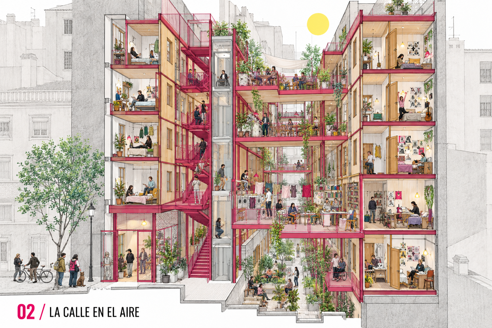

La casa se organiza como una calle que sube: puentes, rellanos y pequeñas plazas conectan grupos de viviendas. Lavar, coser o leer pueden acompañar el recorrido.

**Origen:** Calle en pendiente + galerías habitadas + rituales compartidos.

**Cruce:** Mezclar con 08 y 11: cuidados en los rellanos y estructura de acero.

**Siguiente comprobación:** Comprobar anchuras, evacuación y recorridos accesibles. Los puentes dibujados aún no forman un sistema técnico resuelto.

### 03 · EL SOL ES COMÚN

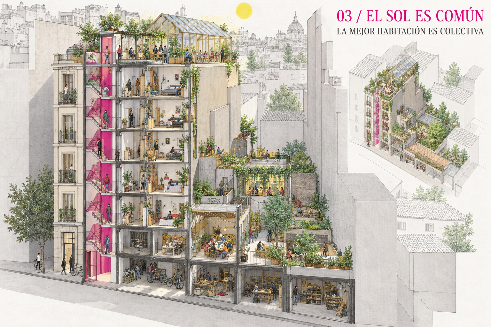

La mejor habitación del edificio pertenece a todas: salón, jardín de invierno y terraza en la parte con más cielo. El volumen se recorta para dejar vacíos debajo.

**Origen:** Modelo de sombras del megapanel + lujo común + reparto de la altura.

**Cruce:** Mezclar con 12 o 14: sala alta de madera o de hormigón y tela.

**Siguiente comprobación:** Provocación volumétrica: la imagen exagera altura y superficie. El dato de 21,1 m procede del modelo previo; no demuestra una altura edificable ni valida la luz de este dibujo.

### 04 · LA CASA INACABABLE

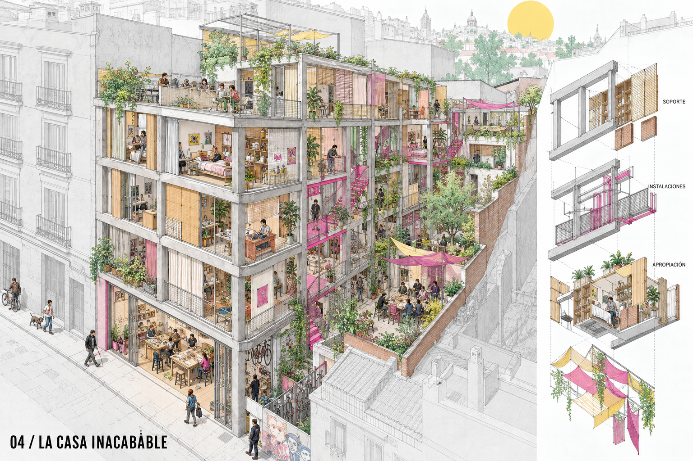

Lo duradero es el soporte y el espacio común; lo modificable son tabiques, muebles, textiles y apropiaciones. Una casa puede admitir cambios sin convertirse en un producto de cápsulas repetidas.

**Origen:** Libreta: poder cambiar el hogar + instalaciones fuera + pertenecer sin quedarse.

**Cruce:** Mezclar con 09, 10 y 15: taller, segunda piel y memoria de habitantes.

**Siguiente comprobación:** Decidir qué puede cambiar cada persona, qué necesita acuerdo y qué debe permanecer por seguridad y mantenimiento.

### 05 · COCINAR TAMBIÉN ES GOBERNAR

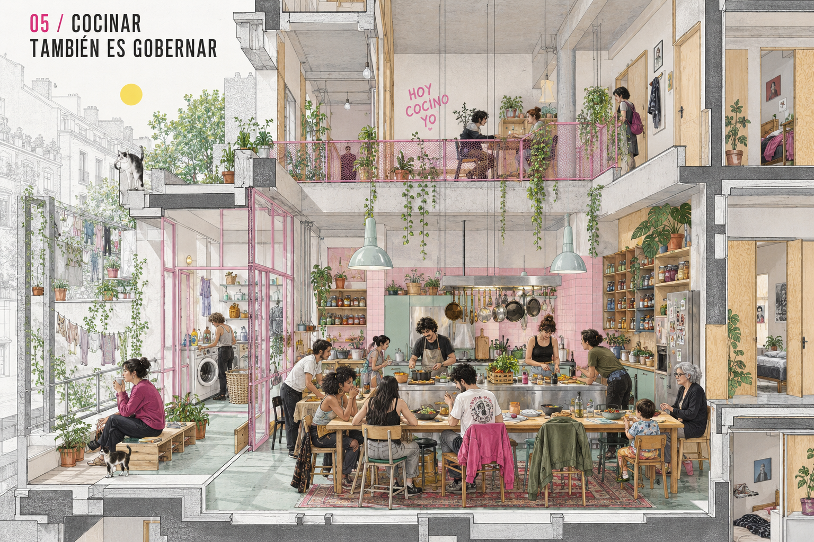

Cocinar reúne comida, conversación y decisiones. La mesa común puede ser comedor y asamblea, mientras sus bordes permiten estar cerca sin participar en todo.

**Origen:** Comisión de comida + cuidados + programa de cocina central.

**Cruce:** Mezclar con 01 y 06: un centro doméstico por grupo, conectado al patio.

**Siguiente comprobación:** La convivencia no sale automáticamente de una mesa grande: hacen falta turnos pactados, limpieza repartida, extracción y opciones para cocinar a solas.

### 06 · EL DERECHO A CERRAR LA PUERTA

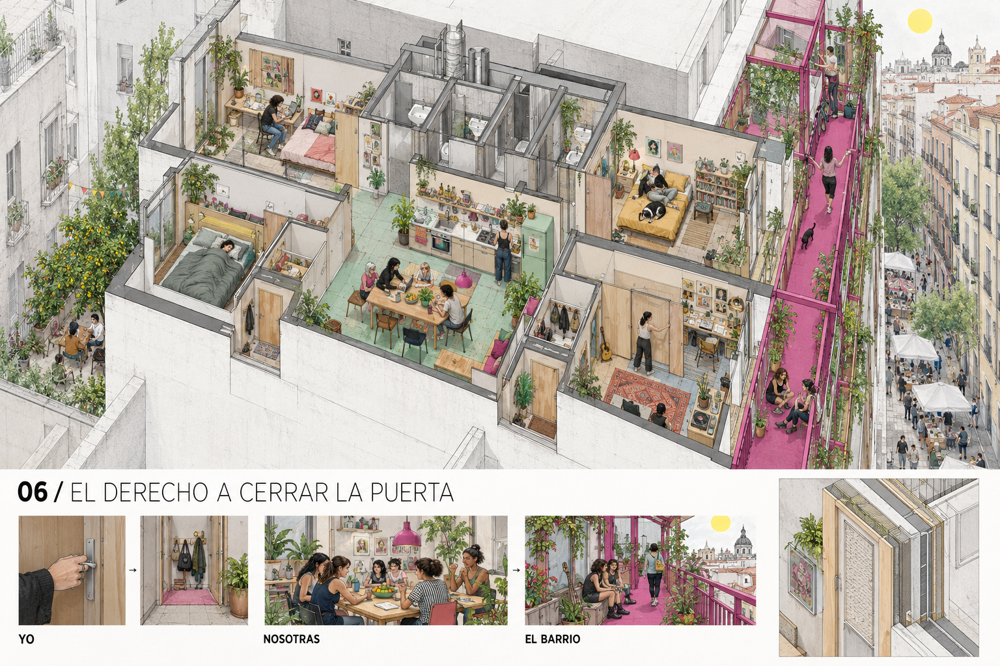

Una puerta propia permite elegir cuándo compartir. Habitación, umbral, casa de grupo y barrio forman escalas diferentes de confianza, ruido y exposición.

**Origen:** Encuesta: silencio e intimidad + privacidad graduada del MD.

**Cruce:** Mezclar con cualquier alternativa 01–04; es una regla de convivencia, no una forma única.

**Siguiente comprobación:** El croquis explora cuatro habitaciones: faltan dimensiones, ventilación, accesibilidad de baños y definición del régimen de cada unidad.

### 07 · EL DOMINGO ENTRA EN CASA

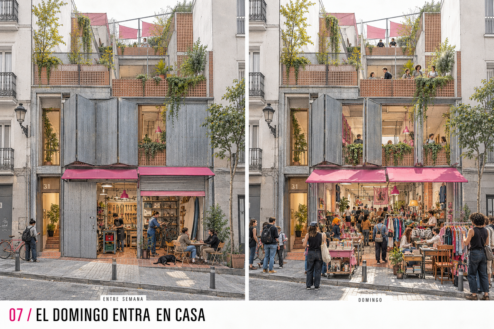

El calendario organiza la planta baja. Mesas, herramientas y cerramientos cambian de posición entre el taller cotidiano y el domingo abierto a la calle.

**Origen:** Sistema dual del Rastro + exposición en acera + comisiones de logística.

**Cruce:** Mezclar con 09 y 10: fabricar dentro, abrir hacia fuera y regular la fachada.

**Siguiente comprobación:** Resolver el desnivel con un acceso sin escalones y mantener paso, evacuación y acceso residencial. Los peldaños de la imagen no resuelven ese objetivo.

### 08 · LA REVOLUCIÓN TIENE LAVADORA

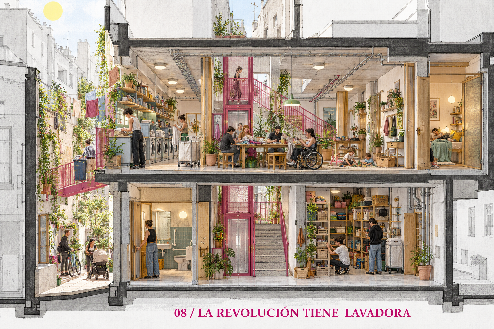

Lavar, reparar ropa, acompañar y descansar dejan de ser trabajo escondido. Una infraestructura próxima facilita compartir tareas sin imponerlas a una persona.

**Origen:** Comisiones de limpieza y cuidados + crítica del trabajo doméstico invisible.

**Cruce:** Mezclar con 02 y 05: rellanos habitables y cocina conectada a cuidados.

**Siguiente comprobación:** Dar aislamiento real al descanso, controlar humedad y ruido de máquinas y acordar cómo se reparten las tareas.

### 09 · PRODUCIR SIN AISLARSE

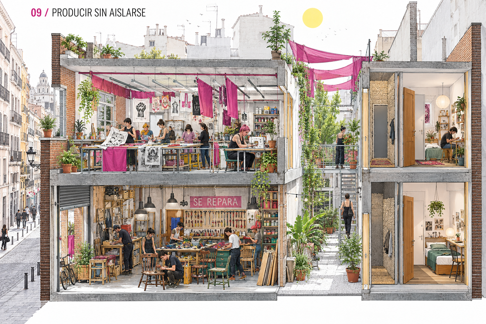

El Rastro alimenta un circuito: recoger, guardar, reparar, transformar, usar y devolver. El taller hace posible que las viviendas y la fachada cambien con sus habitantes.

**Origen:** Casa-taller + economía de reutilización + archivo Generación Z.

**Cruce:** Mezclar con 04, 07 y 10: soporte adaptable, intercambio y textiles hechos en casa.

**Siguiente comprobación:** Separar polvo y ruido de la vivienda, prever extracción y almacenamiento. El aislamiento de la sala de sonido requiere desarrollo específico.

### 10 · UNA FACHADA QUE SE NEGOCIA

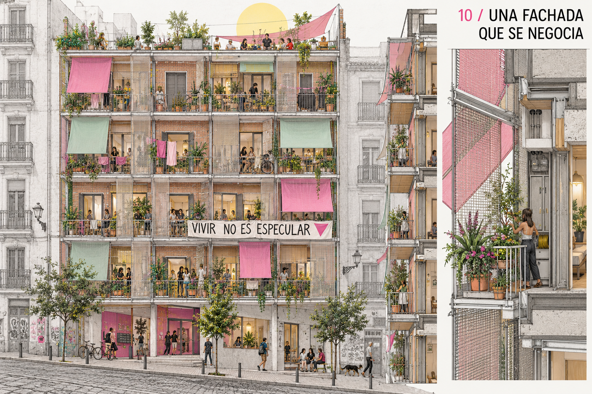

La fachada se ocupa mediante balcones, toldos, plantas y armarios registrables. Una segunda trama permite cuidar la casa desde fuera y regular la relación con la calle.

**Origen:** Patrones de balcón, textil e instalaciones vistas + decisiones de la libreta.

**Cruce:** Mezclar con 04 y 11: un soporte claro para usos y reparaciones diversas.

**Siguiente comprobación:** Precisar anclajes, agua, puentes térmicos, accesibilidad de registros y normas de apropiación; diversidad no significa mantenimiento sin acuerdo.

### 11 · ACERO QUE SE DESATORNILLA

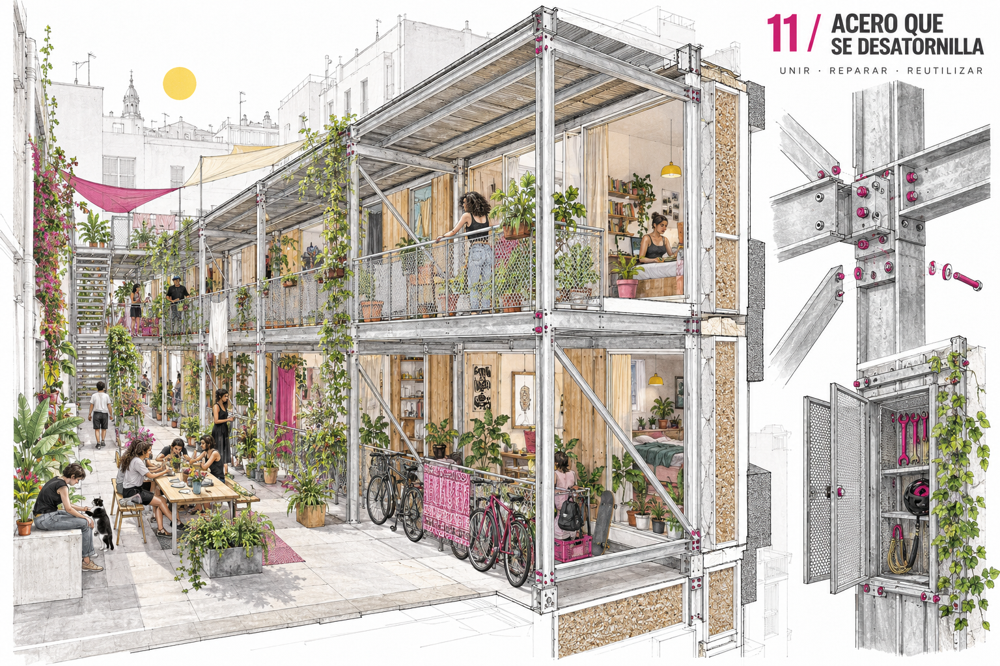

Uniones en seco y piezas accesibles convierten la reparación en una posibilidad visible. El acero permite galerías esbeltas y componentes que se sustituyen sin rehacerlo todo.

**Origen:** Segunda trama + reparación + estructura de larga duración.

**Cruce:** Conecta especialmente con 02 y 10.

**Siguiente comprobación:** El detalle es conceptual: comprobar estabilidad, corrosión, protección al fuego, vibración y acústica. No es un detalle listo para construir.

### 12 · MADERA PARA EL COMÚN

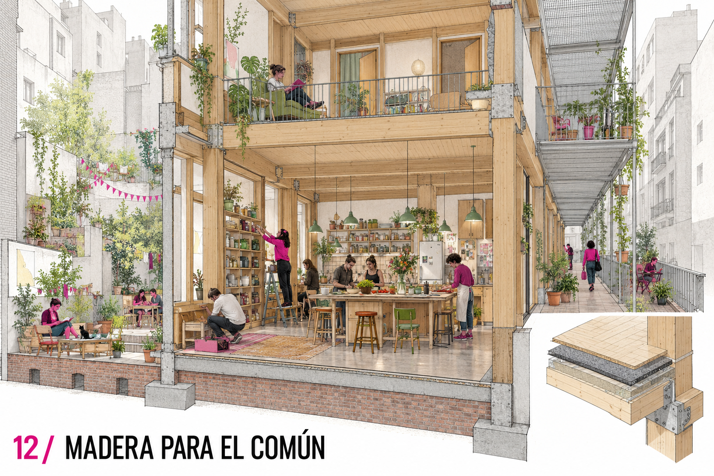

La madera ensaya una atmósfera cálida para el común y un montaje con capas distinguibles. El suelo necesita resolver tanto el apoyo como los sonidos que atraviesan la casa.

**Origen:** Material asequible y elegante + lujo sensorial + trabajo colectivo.

**Cruce:** Conecta con 03, 05 y 06.

**Siguiente comprobación:** Precio y disponibilidad no están calculados. Hay que desarrollar humedad, fuego, acústica y protección exterior.

### 13 · LADRILLO CON MEMORIA

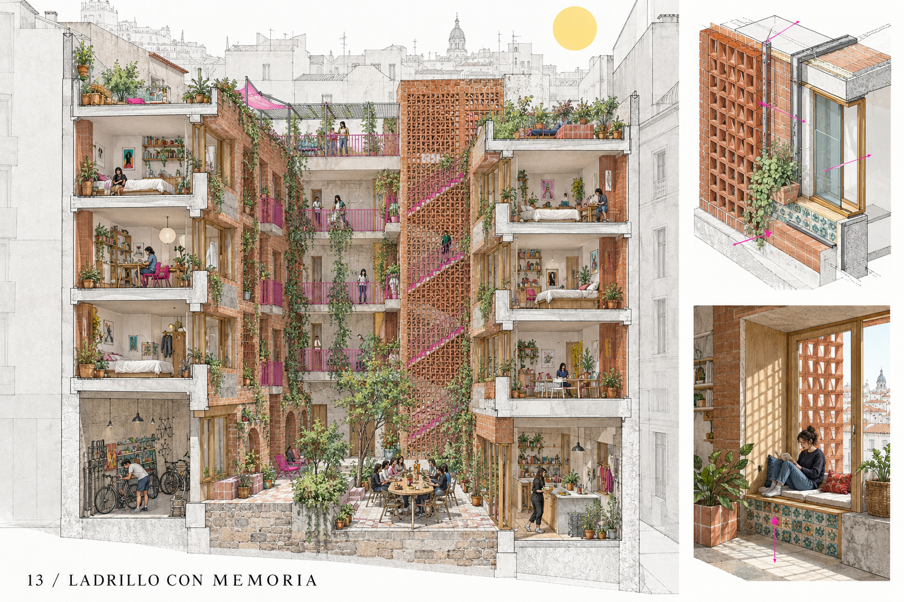

Ladrillo, cerámica y piedra recuperada devuelven espesor a los límites: sentarse, apoyar, filtrar miradas y producir sombra. La memoria material se transforma en uso.

**Origen:** Fotos de patrones del barrio + corrala + reutilización del Rastro.

**Cruce:** Conecta con 01, 07 y 10.

**Siguiente comprobación:** La celosía filtra; no sustituye el cerramiento térmico. Ensayar peso, puesta en obra, suministro recuperado y mantenimiento.

### 14 · HORMIGÓN, AIRE Y TELA

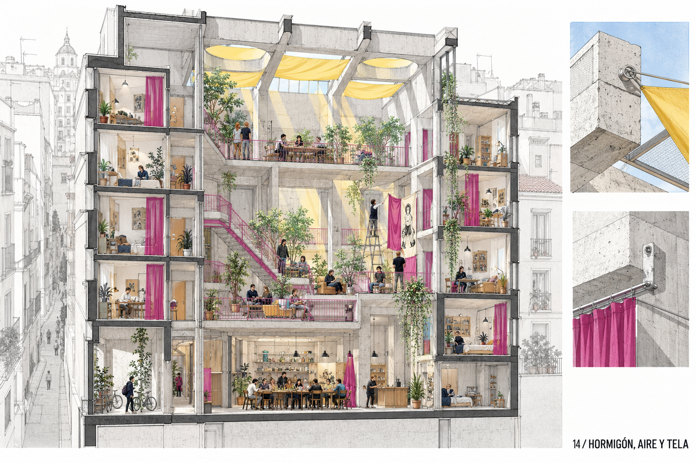

Una estructura de hormigón deja grandes vacíos para la vida compartida. La tela se coloca donde hace falta sombra y puede salir del propio taller textil.

**Origen:** Libreta de Atocha + mucho aire + textiles debajo del sol.

**Cruce:** Conecta con 03, 04 y 09.

**Siguiente comprobación:** Comparar impacto y coste con otras estructuras. Dibujar cubierta, aislamiento y control del sobrecalentamiento antes de fijar la solución.

### 15 · PERTENECER SIN QUEDARSE

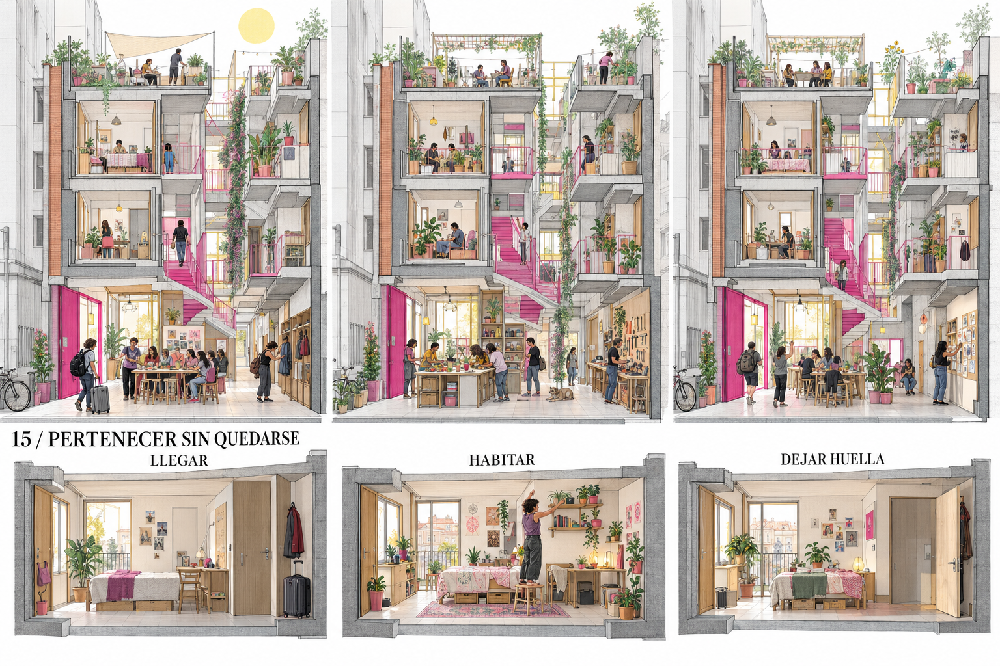

Llegar, habitar y dejar huella. La persona conserva una habitación estable durante su estancia; al irse puede dejar una planta, un mueble o conocimiento en el archivo común.

**Origen:** Rotación del MD + pertenecer sin quedarse + muro de memoria.

**Cruce:** Conecta con 04, 06 y 09.

**Siguiente comprobación:** La temporalidad no se traduce en compartir cama por turnos. Definir acogida, duración, salida y derechos sin precarizar la estancia.

### 16 · LA ACAMPADA QUE PERMANECE

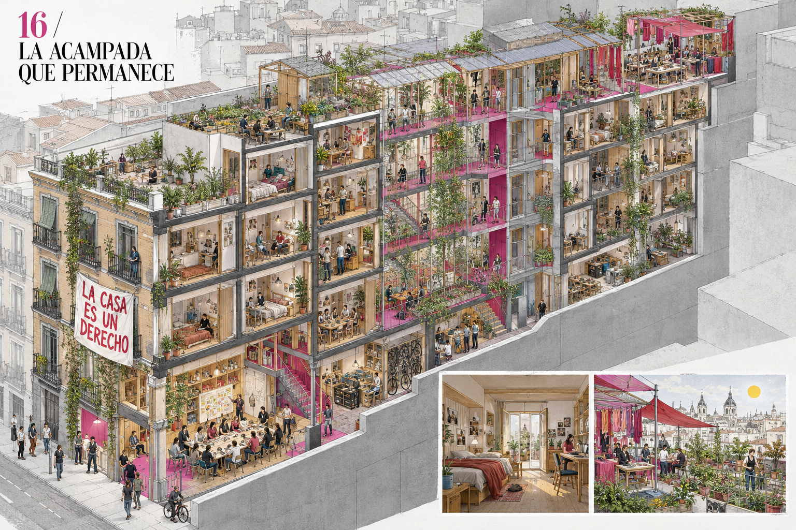

Habitación, grupo, comunidad y barrio forman una secuencia. La asamblea se vincula a la calle; los cuidados y la producción sostienen lo doméstico; el sol se reparte arriba.

**Origen:** Cruce de Sol, corrala, Rastro, encuesta y libretas.

**Cruce:** Punto de partida para dibujar una planta propia mezclando 01 + 03 + 06 + 07 + 09.

**Siguiente comprobación:** Es un manifiesto espacial, no una solución cerrada. Propiedad y gobierno colectivos deben definirse junto con el edificio; una pancarta no los garantiza.

## Fuentes locales leídas o inspeccionadas

- Conversación completa: /Users/adam/Downloads/G3_Acampada_Sol_conversacion.md.
- Megapanel: /Volumes/T7/G3 Proyectos/INVESTIGACIÓN/PANEL_FINAL_5xA3/RIBERA31_MEGAPANEL_5xA3.pdf y versión PNG.
- Guía de lectura: /Volumes/T7/G3 Proyectos/INVESTIGACIÓN/PANEL_FINAL_5xA3/RIBERA31_GUIA_DE_LECTURA.pdf.
- Compendio: /Volumes/T7/G3 Proyectos/INVESTIGACIÓN/00_INVESTIGACION_COMPLETA/RIBERA_31_COMPENDIO_INVESTIGACION.pdf (revisión de estructura y selección de contenidos; el megapanel y su guía son la síntesis principal utilizada).
- Fotografías de patrones: /Volumes/T7/G3 Proyectos/INVESTIGACIÓN/PANEL_FINAL_5xA3/_trabajo_previews/fotos_patrones.jpg.
- Referencias visuales: REFERENCIA VISUAL MÁS IMPORTANTE.png y panel de Romain revisado en _trabajo_previews/romain_3.jpg.
- Bóveda enlazada desde el índice del proyecto: /Volumes/T7/obsidian/creATIveb@bY/CEREBRO DE PROYECTOS/; libretas 01 y 02, Criterios de proyecto v1, Programa Generación Z, selección GZ 05 Cómo dibujan y Reglas IRAXXXDIOS de diagramación.

## Alcance y lectura de las imágenes

Todos los dibujos son hipótesis C. El archivo describe ≈651 m² de parcela, ≈14,9 m de frente y hasta ≈49,5 m de fondo; esas dos longitudes no describen un rectángulo de 651 m². El encargo recogido es ≈1.500 m² para ≈20 unidades y ≈40 jóvenes. Los dibujos exploran posibilidades, no verifican esas superficies: la 03 exagera la altura deliberadamente y las demás también requieren ajuste al perímetro real.

El contexto urbano, el número de plantas, la vegetación y la luz de las ilustraciones son interpretaciones. Se revisaron visualmente composición, títulos y legibilidad; persisten simplificaciones geométricas propias de dibujos generados. No hay comprobación de normativa, estructura, incendios, accesibilidad, acústica, energía o coste. Los accesos con escalones y detalles de uniones son preguntas de trabajo, no soluciones resueltas.

Las noticias, estadísticas y bibliografía del MD se toman como material aportado, sin verificación externa en esta exploración visual. No se trasladan sus cifras de actualidad a los dibujos. Las instrucciones archivadas en ese documento sobre elaborar un Word se entienden como historia de la conversación, no como el encargo actual.

